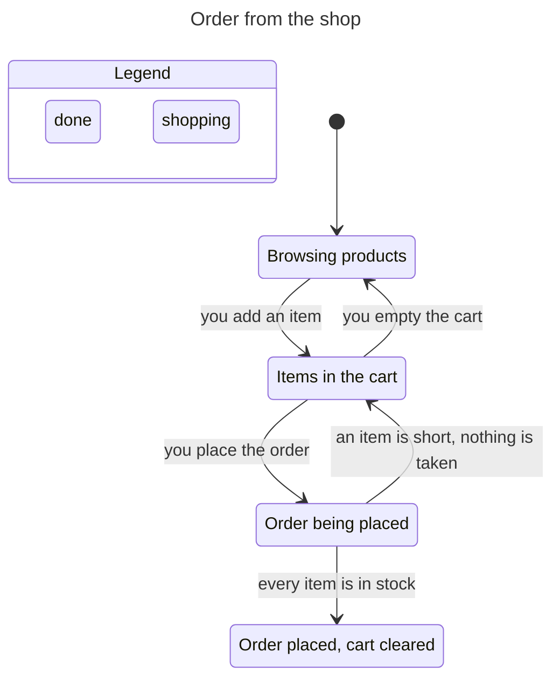

# Checkout verification

| Skill | What it checks | Tool |
| --- | --- | --- |
| [verify-checkout-stock](../../.claude/skills/verify-checkout-stock/SKILL.md) | Refused orders take no stock; stock never goes negative | TLA+ / TLC, 9 states, plus `tests/test_order_rules.py` |

Fixed along the way:

1. The app could not start: `<str:username>` is not a Flask converter (e53c0bb).
2. Deletes and checkout crashed under the current fastlite, which has no `cursor.rowcount` and returns inserted rows as dicts (7cdfc86, 9cdc3e1).
3. A refused order kept the stock of the items before the short one, and concurrent orders could oversell (2ad169f).
4. Zero and negative cart quantities were accepted and added stock back at checkout (f1f138e).
5. Anyone could register as an admin with `is_admin` (fb8d9d4).

`test_auth.py::test_login`, `test_auth.py::test_logout` and `test_cart.py::test_add_to_cart` still fail. They log in as a user they never register and expect 200 where the route returns 201.

## Order from the shop

Generated with pstack `/statechart` from [Shop.tla](flows/checkout/Shop.tla) ([TLC report](flows/checkout/report.md)).

